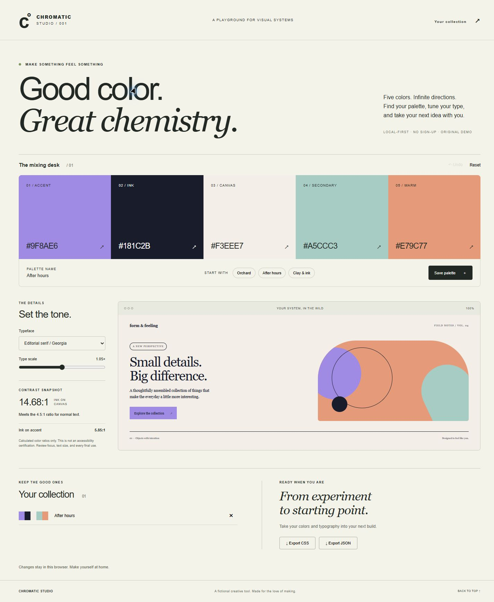
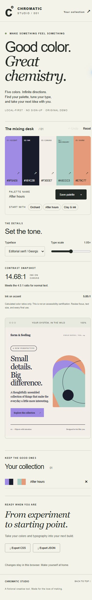

# Chromatic Studio

A local-first design-token playground with a warm editorial interface, five-color mixing desk, and a live component canvas. Original fictional portfolio project; no client work, user accounts, tracking, or external services.

## Features

- Five editable semantic color roles and three original starting palettes.
- Sans, serif, and mono typography with adjustable scale, previewed in a miniature editorial interface and original CSS artwork.
- Computed ink/canvas and ink/accent contrast ratios with threshold explanations. These checks are not an accessibility certification.
- Named saved palettes (up to 12), local persistence, deletion, 30-step workspace undo, and reversible reset.
- Downloadable CSS custom properties and versioned JSON tokens.
- Responsive layouts, skip link, labeled native controls, visible keyboard focus, reduced-motion support, and graceful storage-failure handling.

## Run locally

Requires Node.js 22 or newer. No package installation is necessary: this project has **zero runtime and development dependencies**. A dependency-free lockfile is included.

```sh
node scripts/serve.mjs
# http://127.0.0.1:4171
node --test
node scripts/build.mjs
node scripts/serve.mjs --dist
```

Standard `npm run dev`, `npm test`, and `npm run build` aliases are also provided when npm is installed. Set `PORT` to change the local server port. The server binds to loopback only. Publish the four generated `dist/` assets to any static host with ES-module support.

## Architecture

`tokens.js` contains pure, tested contrast calculations, state normalization, CSS generation, and undo logic. `app.js` owns DOM rendering, local persistence, download flows, and interaction state. `style.css` defines the responsive interface and original geometric artwork. `scripts/` contains dependency-free development and build tools. `test/` uses Node's built-in test runner.

Persisted values are validated on load. Names render as text, not HTML. Colors use six-digit hex validation. CSS comments are sanitized during export. Storage failures preserve the in-memory editing flow. No network requests are made by the application.

## Validation and limitations

Seven automated tests cover reference contrast values, symmetry, malformed colors and persistence, bounded state, safe CSS export, and undo behavior. Run the commands above to reproduce results. Browser review and captured screenshots are documented separately when available; the source alone does not imply a browser test has run.

The preview is a fictional component demonstration, not a storefront. The font choices use system fonts and can vary by platform. Contrast thresholds do not account for all accessibility requirements. Saved palettes stay in this browser and may be cleared by the browser; export important work. Photos, external fonts, analytics, APIs, paid services, and third-party assets are not used. No open-source license is assigned.

## Screenshots

Actual browser captures from desktop and phone layouts:






Detailed executed checks and verification limits: [QA record](QA.md).
